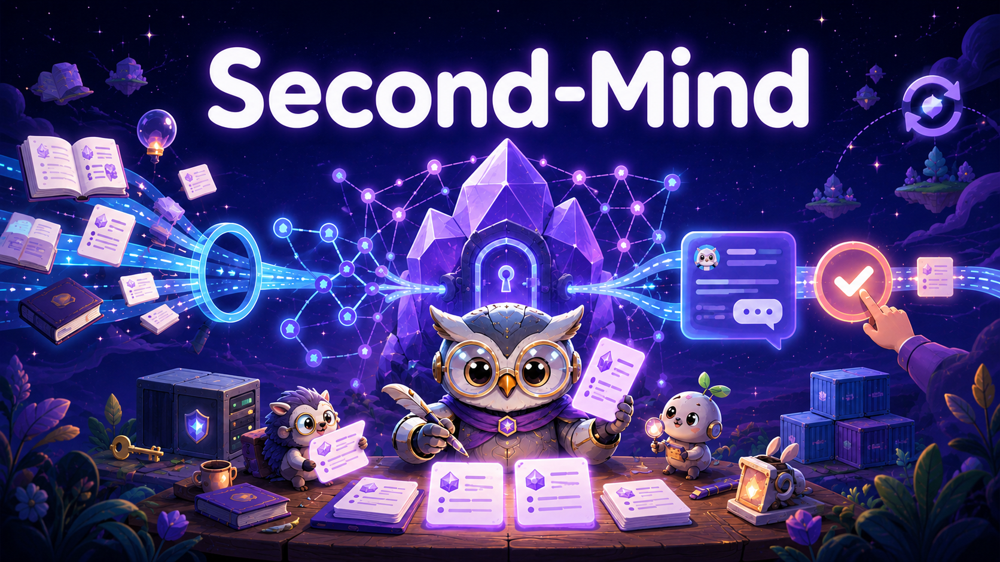
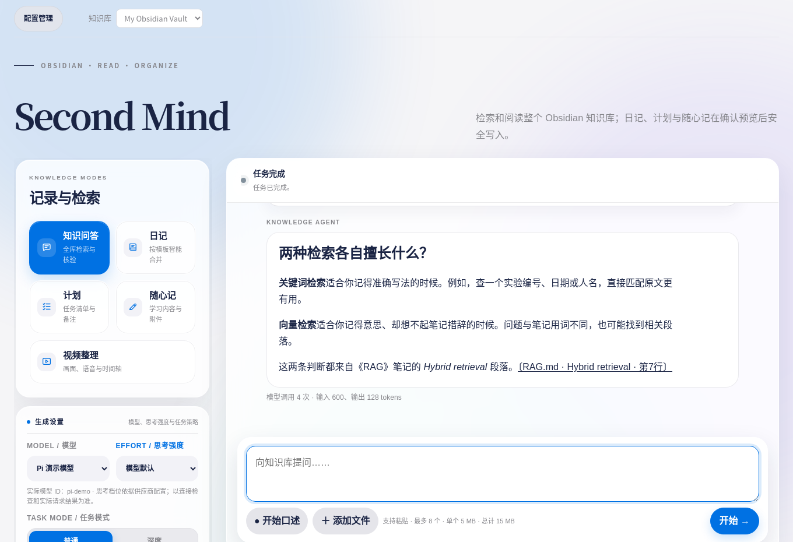
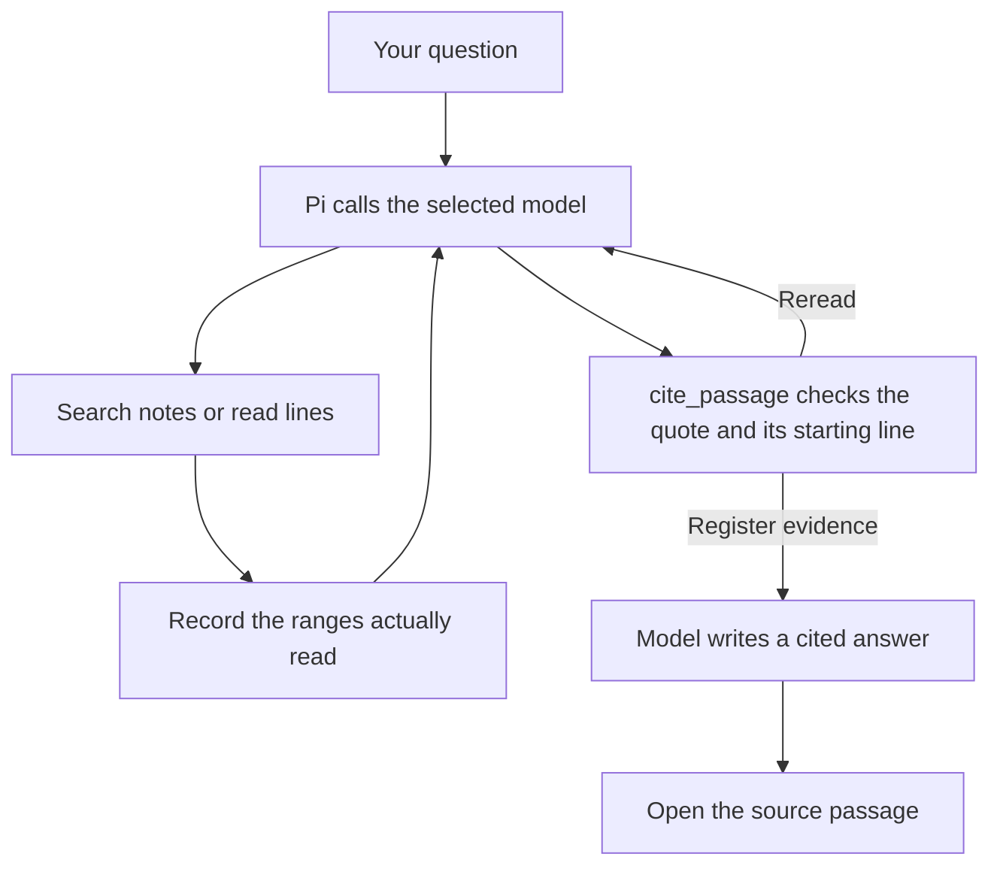

<p align="center">
  <a href="docs/assets/second-mind-hero.png"></a>
</p>

<h1 align="center">Second Mind · Pi Agent Edition</h1>
<p align="center">Ask your Obsidian notes a question. Open a citation to read the line behind the answer.</p>

<p align="center">
  <a href="https://github.com/kygoyuan2004/Second_Mind_PIAGENT_OPTIMIZE/actions/workflows/ci.yml"></a>
  · <a href="README.md">简体中文</a>
  · <a href="#quick-start">Run from source</a>
  · <a href="#comparison">Compare editions</a>
  · <a href="MIGRATION_REPORT.md">Migration results</a>
</p>

Second Mind is a self-hosted Obsidian workspace for one administrator. Ask when your notes recommend keyword search over vector search. Pi searches the selected Vault, reads the matching passages, and can go back for more evidence. The task record shows each tool call and the number of model calls. Open a citation to judge the answer for yourself.

[](docs/assets/second-mind-pi-qa.png)

*The running Pi app with the repository’s public RAG note and reproducible responses from a local model fixture.*

<a name="comparison"></a>

## What changed from Second Mind?

The comparison uses the upstream revision that shipped Claude Agent SDK 0.3.247. It already supported multi-turn Q&A, passage citations, hybrid retrieval, deep questions and read-only subagents. [Upstream source](https://github.com/kygoyuan2004/Second-Mind/tree/b54ac6ba637981b43804874e9fcbecc1d1468718)

| Capability | Upstream Second Mind | Pi Agent Edition |
| --- | --- | --- |
| Tool scheduling | Claude Agent SDK drove the loop with built-in readers and knowledge MCP tools | Open-source Pi Agent Core 1.6.0 runs in-process. The model can read, search and correct mistakes over multiple turns, with up to six concurrent read-only calls in one turn |
| Model connections | Q&A required a native Anthropic Messages endpoint | Pi AI 1.6.0 speaks both Anthropic Messages and OpenAI Chat Completions. A tool-capable local model can use an explicitly configured loopback endpoint |
| Reading coverage | A task recorded retrieval and reading activity | Sandboxed reads start at line 1. An interval tree merges overlapping ranges and distinguishes complete, partial, unread and failed reads |
| Citations | Registered verbatim passages as evidence | `cite_passage` verifies the quotation and its supplied starting line. The model can reread after a mismatch, and streaming output filters unregistered evidence identifiers |
| Conversations and usage | SDK sessions carried conversations forward and thinking events displayed token estimates | Change model, protocol or reasoning effort in the same conversation. The task shows model calls and provider-reported input/output tokens, including how many calls reported usage when totals are partial |

Ordinary Q&A retains its 20-turn, 10-minute limit. Deep Q&A can use up to 50 turns, 30 minutes and two read-only subagents. Per-Vault indexes, learning reviews and the draft approval flow for diaries, plans and scratch notes are also available.

<a name="quick-start"></a>

## Desktop and Docker

Install Pi alongside Claude SDK on Windows or Linux x64. Native Apple Silicon and Intel disk images target macOS 14 or later. See the [release files and checksums](https://github.com/kygoyuan2004/Second_Mind_PIAGENT_OPTIMIZE/releases) and [macOS first launch guide](docs/macos-desktop.md). Docker uses local port `8788` with independent settings, credentials and volumes. When both editions use the same Obsidian Vault, run writing tasks one edition at a time.

## Ask your first question from source

Install Git and Node.js (22.x starting at 22.22.0, or 24.8.0 and later). In a fresh directory, clone this edition and install the locked dependencies.

```sh
git clone https://github.com/kygoyuan2004/Second_Mind_PIAGENT_OPTIMIZE.git
cd Second_Mind_PIAGENT_OPTIMIZE
npm ci
```

**1. Prepare the demo Vault.** On Linux, macOS or Git Bash, copy the three public notes into the private `vault` directory.

```sh
cp .env.example .env
mkdir -p vault/.obsidian
cp -R examples/demo-vault/. vault/
```

<details>
<summary>Windows PowerShell commands</summary>

```powershell
Copy-Item .env.example .env
New-Item -ItemType Directory -Force vault/.obsidian | Out-Null
Copy-Item examples/demo-vault/* vault/ -Recurse
```

</details>

**2. Set up login and start the server.** Edit `.env` and set `ADMIN_PASSWORD` (at least 12 characters) and `SESSION_SECRET` (at least 32 characters). The first command below generates a random session secret. The default account is `admin`. Open `http://127.0.0.1:8787` or set a different `PORT` in `.env`.

```sh
node -e "console.log(require('node:crypto').randomBytes(32).toString('hex'))"
npm start
```

**3. Ask and verify.** Sign in, open model settings (配置管理), add a tool-capable model, select its protocol, test the connection and save. In Knowledge Q&A (知识问答), ask **“According to my RAG note, when should I use keyword search and when should I use vector search? Quote the source.”** Open the citation and compare it with the *Hybrid retrieval* section in `Learning/RAG.md`. Keyword retrieval works immediately. You can enable semantic indexing separately. [Model and index settings](docs/configuration.md)

## How an answer gets its evidence



Q&A reads from the selected Vault. An external model receives the question, conversation context and excerpts returned by tools. Building a remote embedding index sends eligible note chunks to the selected service. Diaries and plans stay in a draft outside the Vault until you confirm the write. [Data flow](docs/data-flow.md) · [Architecture](docs/architecture.md)

<a name="docs"></a>

## Deployment and development

| Goal | Guide |
| --- | --- |
| Deploy with Docker, back up or restore an instance | [Deployment](docs/deployment.md) · [Linux](docs/quickstart-linux.md) · [macOS](docs/quickstart-macos.md) · [Windows](docs/quickstart-windows.md) |
| Run or package the desktop app from source | [Electron desktop](desktop/README.md) · [Windows builds](docs/windows-build.md) |
| Review the tool loop, tests and platform coverage | [Migration results](MIGRATION_REPORT.md) · [HTTP / SSE API](docs/api.md) |

```sh
npm run check && npm test && npm run security:scan
npm run site:check
```

The owl artwork and MIT license carry forward from Second Mind. Dependencies retain their respective licenses. [Upstream project](https://github.com/kygoyuan2004/Second-Mind) · [Contributing](CONTRIBUTING.md) · [MIT](LICENSE)
