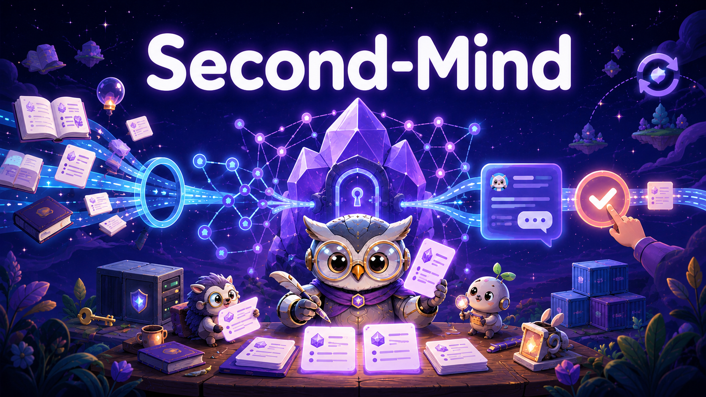
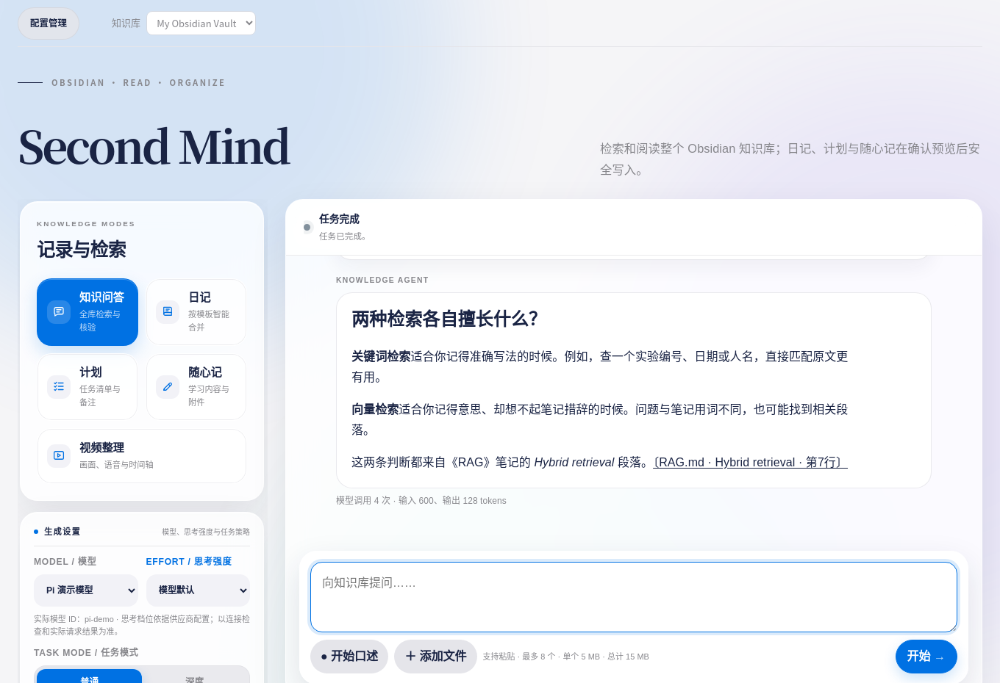
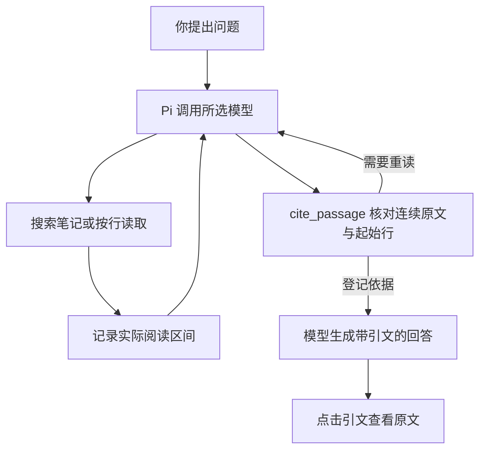

<p align="center">
  <a href="docs/assets/second-mind-hero.png"></a>
</p>

<h1 align="center">Second Mind · Pi Agent 版</h1>
<p align="center">向自己的 Obsidian 笔记提问，点开回答中的引文，回到写下它的那一行。</p>

<p align="center">
  <a href="https://github.com/kygoyuan2004/Second_Mind_PIAGENT_OPTIMIZE/actions/workflows/ci.yml"></a>
  · <a href="README.en.md">English</a>
  · <a href="#quick-start">从源码试用</a>
  · <a href="#comparison">与原版对比</a>
  · <a href="MIGRATION_REPORT.md">迁移验收</a>
</p>

Second Mind 是面向单管理员的自托管 Obsidian 工作台。你可以问「我的笔记里，关键词检索和向量检索分别适合什么情况？」。Pi 会在所选知识库搜索、读原文，必要时再查一轮。展开任务记录，可以看到它实际调用了几次模型、用了哪些工具；点开引文，可以自己判断答案是否站得住脚。

[](docs/assets/second-mind-pi-qa.png)

*Pi 版实机界面。截图使用仓库附带的公开 RAG 笔记和可复现的本地模拟模型响应。*

<a name="comparison"></a>

## 与原版 Second Mind 有什么不同？

对比基线是采用 Claude Agent SDK 0.3.247 的原版。原版已经支持多轮问答、段落引文、混合检索、深度问答和只读子任务。[原版源码](https://github.com/kygoyuan2004/Second-Mind/tree/b54ac6ba637981b43804874e9fcbecc1d1468718)

| 能力 | 原版 | Pi Agent 版 |
| --- | --- | --- |
| 工具调度 | Claude Agent SDK 决定下一轮调用，结合内置读取工具和知识库 MCP | 进程内运行开源 Pi Agent Core 1.6.0。模型可连着多轮读、查、纠错，同轮最多并发 6 个只读调用 |
| 模型连接 | 知识问答要求原生 Anthropic Messages 端点 | Pi AI 1.6.0 支持 Anthropic Messages 和 OpenAI Chat Completions，可接入支持工具调用的本机回环端点 |
| 阅读覆盖 | 可查看检索与读取记录 | 从第 1 行起在沙箱内分段读取，用区间树合并重复或重叠范围，区分全文已读、部分已读、未读与失败 |
| 引用核验 | 确认连续原文并登记段落依据 | `cite_passage` 校验引文和传入的起始行。行号有误时模型可重读，流式输出会过滤未登记的依据标识 |
| 会话与用量 | 使用 SDK 会话续聊，思考事件展示估算 token | 同一对话可切换模型、协议和推理强度。任务展示实际模型调用次数和供应商报告的输入、输出 token，缺报时标注统计范围 |

普通问答保留 20 轮、10 分钟的上限。深度问答最多 50 轮、30 分钟，可按需启用两个只读子任务。多库独立索引、学习回顾，以及日记、计划、随心记的草稿确认流程也都保留。

<a name="quick-start"></a>

## 从源码问第一个问题

需要 Git 和 Node.js（22.x 从 22.22.0 起，或 24.8.0 及以上）。在一个新目录克隆项目并安装锁定的依赖。

```sh
git clone https://github.com/kygoyuan2004/Second_Mind_PIAGENT_OPTIMIZE.git
cd Second_Mind_PIAGENT_OPTIMIZE
npm ci
```

**1. 准备演示库。** 在 Linux、macOS 或 Git Bash 中执行以下命令，把三篇公开笔记放入独立的 `vault`。

```sh
cp .env.example .env
mkdir -p vault/.obsidian
cp -R examples/demo-vault/. vault/
```

<details>
<summary>Windows PowerShell 命令</summary>

```powershell
Copy-Item .env.example .env
New-Item -ItemType Directory -Force vault/.obsidian | Out-Null
Copy-Item examples/demo-vault/* vault/ -Recurse
```

</details>

**2. 配置登录并启动。** 在 `.env` 填入自己的 `ADMIN_PASSWORD`（至少 12 个字符）和 `SESSION_SECRET`（至少 32 个字符）。下面第一行可生成随机会话密钥。默认账号是 `admin`，网址是 `http://127.0.0.1:8787`，端口可在 `.env` 中调整。

```sh
node -e "console.log(require('node:crypto').randomBytes(32).toString('hex'))"
npm start
```

**3. 提问并核对。** 登录，打开「配置管理」，添加支持工具调用的模型，选择与端点对应的协议，检查连接并保存。回到「知识问答」，试问 **“根据 RAG 笔记，什么时候用关键词检索，什么时候用向量检索？请引用原文。”** 点开引用，对照 `Learning/RAG.md` 的 `Hybrid retrieval` 段落。关键词检索开箱可用，语义索引可按需单独启用。[模型与索引配置](docs/configuration.md)

## 一次回答如何找到依据



知识问答只读当前选中的库。使用外部模型时，问题、对话上下文和工具读到的片段会发给所选端点。启用远程 Embedding 时，建索引会发送符合条件的笔记片段。日记和计划先保存为库外草稿，确认后才写入 Vault。[数据流](docs/data-flow.md) · [架构](docs/architecture.md)

<a name="docs"></a>

## 部署与开发

| 你的目标 | 入口 |
| --- | --- |
| 使用 Docker 部署、备份或恢复 | [部署手册](docs/deployment.md) · [Linux](docs/quickstart-linux.md) · [macOS](docs/quickstart-macos.md) · [Windows](docs/quickstart-windows.md) |
| 从源码运行桌面版或打包 | [Electron 桌面端](desktop/README.md) · [Windows 构建](docs/windows-build.md) |
| 查看工具循环、测试和平台实测范围 | [迁移验收报告](MIGRATION_REPORT.md) · [HTTP / SSE 接口](docs/api.md) |

```sh
npm run check && npm test && npm run security:scan
npm run site:check
```

沿用 Second Mind 的猫头鹰插画与 MIT 许可证。第三方依赖保留各自许可证。[原项目](https://github.com/kygoyuan2004/Second-Mind) · [贡献指南](CONTRIBUTING.md) · [MIT](LICENSE)
