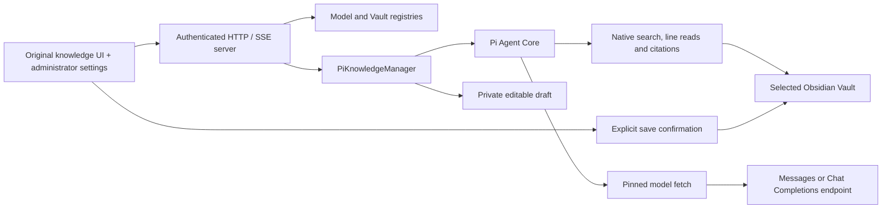

# Architecture

Pi Agent Core 1.6.0 runs the multi-step tool loop. Pi AI 1.6.0 streams requests in the protocol configured for the selected model.

## Source map

| Component | Implementation |
| --- | --- |
| Prompts, tool loop and task events | `src/pi-prompts.mjs`, `src/pi-agent-executor.mjs`, `src/original/knowledge-agent.mjs` |
| Original retrieval, tokenizer, chunks, caches and RRF | `src/original/knowledge-index.mjs`, `knowledge-store.mjs`, `bailian-retrieval.mjs` |
| Original task modes, learning review and subagent policy | `src/original/task-modes.mjs`, `learning-review.mjs`, `subagent-policy.mjs` |
| Model bindings and pinned transport | `src/pi-runtime.mjs`, `src/pi-model-adapter.mjs`, `src/model-transport.mjs` |
| Managed models, tools and lifecycle | `src/pi-knowledge-manager.mjs`, `src/pi-vault-tools.mjs` |
| Additive old-state import and confirmed writes | `src/sdk-state-migration.mjs`, `sdk-knowledge-store.mjs` |
| Per-Vault index activation and runtime | `src/sdk-knowledge-index.mjs`, `knowledge-base-runtime.mjs`, `embedding-runtime.mjs` |
| Web search and extraction | `src/pi-web-tools.mjs`, `src/safe-web-reader.mjs` |
| Speech/video | `src/original/knowledge-transcriber.mjs`, `knowledge-video.mjs`, `src/scripts/*.py` |
| Original browser interface | `public/knowledge.html`, `knowledge.js`, `knowledge.css`, source and clipboard helpers |
| Retained administration | `public/admin-config.*`, `runtime-config-registry.mjs`, `provider-config-service.mjs`, `knowledge-base-registry.mjs` |

## Startup and persistence

The HTTP listener exposes liveness before index initialization finishes. Other routes return `503` during initialization; readiness reflects available knowledge bases. Startup does not call paid models or build a first remote embedding index.

Each registered Vault owns private `sdk-v1` state: conversation messages, drafts, index/profile slots, audit records, recovery files, and migration receipts. The original state remains beside it. Model configuration is shared; selected-Vault embedding activation is separate. Configuration saves affect subsequent tasks, while an active task retains its connection snapshot. The next turn can use another configured model with the same saved conversation.

## Execution

Normal tasks keep the original 20-turn/10-minute limit. Deep Q&A keeps 50 turns/30 minutes and at most two conditional read-only subagents. Learning reviews use 50 turns/30 minutes, at most 40 read/search calls and a 24-minute reading phase. The executor compacts older cited reads while preserving the system prompt and tool declarations. Up to six native reads can run concurrently. A per-file interval tree records coverage, and the server verifies quotations before issuing citation markers.

Only the selected Vault is accessible to the read tools. The path policy checks exclusions, symbolic links and reparse points. The server adds the configured credential to the selected upstream request in memory.

See [Pi migration report](../MIGRATION_REPORT.md), [data flow](data-flow.md), and [API](api.md). The [v0.2.1 source archive](https://github.com/kygoyuan2004/Second-Mind/tree/v0.2.1/archive/pi) preserves the previous Pi implementation and its tests.
